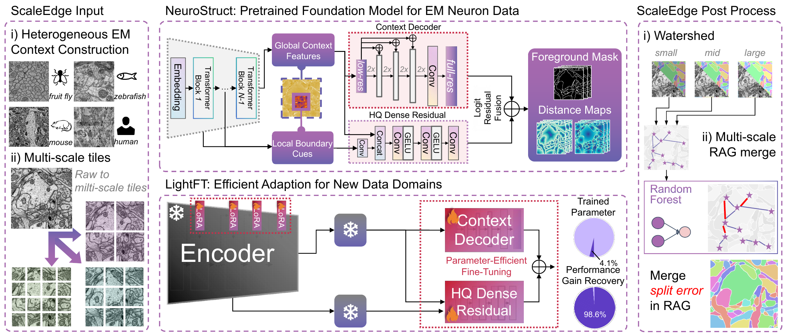

# UniSEM

### Two-Stage Training and Efficient Specialization for EM Neuron Instance Segmentation

**A reusable EM segmentation model that becomes a dataset specialist with lightweight updates.**

UniSEM combines prompt-free dense prediction with HQ-inspired cross-layer
refinement. First-stage training establishes reusable EM segmentation
capabilities; second-stage training specializes the complete model on target
data with LightFT or full-parameter fine-tuning.

[Project page](https://oxidationreduction.github.io/UniSEM-ISBI/) ·
[Run in Colab](https://colab.research.google.com/github/oxidationreduction/UniSEM-ISBI/blob/main/notebooks/UniSEM_Colab.ipynb) · [Models](models/README.md) ·
[Installation](docs/installation.md) · [Your data](docs/data.md) ·
[Specialization](docs/specialization.md) · [Evaluation](docs/evaluation.md)



## Explore the results first

Browse the [hosted project page](https://oxidationreduction.github.io/UniSEM-ISBI/),
or run the same viewer locally without a GPU, model installation, or internet connection:

```bash
python tools/serve.py
```

Open **http://127.0.0.1:8787**. Compare actual precomputed predictions, select
an improvement or residual-error case, drag the divider, and inspect Raw and
GT with synchronized zoom. The GIF shows existing predictions, not online
inference. Press Ctrl+C in the server terminal to stop.

To segment an image of your own, open the [Colab notebook](docs/colab.md).
It prepares the model environment, downloads the first-stage model and its
matching RF, and lets you upload, inspect, segment, and download your data.

This repository provides the research reference implementation and static
project page. First-stage weights are distributed separately through
[Hugging Face](https://huggingface.co/dreamBuilder/UniSEM); target LightFT and
FullFT assets remain local release candidates. The manuscript and supplement are Chinese drafts;
code, documentation, and the website are English. Final author and citation
metadata remain to be supplied.

## What the study shows

| Question | Evidence in the current study |
|---|---|
| Prompt-free instance quality | Lower overall VOI and ARAND than the listed external baselines on EMNeuron and WaferEM. |
| Structural design | Cross-layer refinement has the lowest mean errors among the tested structural routes; both structure and initialization vary across routes. |
| Two-stage training | Matched target comparisons support source-model reuse and subsequent target specialization. |
| Annotation efficiency | With about one quarter of target labels, two-stage training outperforms the no-first-stage control using all labels in the tested WaferEM pipeline. |
| Parameter efficiency | LightFT updates 13.20M parameters, about 4.1% of FullFT, with similar measured instance quality. |

The task is **2D, slice-wise instance segmentation**. The parameter ratio is
not a measured speed or memory ratio. The target evidence uses one fixed test
volume; no universal superiority, 3D-connectivity improvement, or strict
statistical equivalence is asserted. See the website for conditions and uncertainty.

## Install the model package

Use Linux and Python 3.10 for the reference model environment:

```bash
conda env create -f environment.sam.yml
conda activate unisem
python -m pip install --constraint constraints.txt -e '.[test]'
unisem --help
```

See [installation](docs/installation.md) for CPU/CUDA and Windows guidance.
The static viewer runs independently on Windows.

## Segment your own image

Download the first-stage model and paired RF from the model repository, or use
the Colab notebook to obtain and verify them automatically. For local use, place
the files in `artifacts/`. Exact filenames, hashes, immutable download URLs,
and RF pairings are in [models/manifest.json](models/manifest.json).

```bash
unisem infer --dataset emneuron \
  --config configs/paper_protocol.json \
  --checkpoint artifacts/unisem_stage1_emneuron_vitl.pt \
  --rag-checkpoint artifacts/unisem_stage1_emneuron_full55_rf.joblib \
  --input datasets/example.tif --output outputs/example.h5 --device cuda
```

For locally available LightFT assets, also provide the matching first-stage model:

```bash
unisem infer --dataset waferem \
  --config configs/paper_protocol.json \
  --checkpoint artifacts/unisem_lightft_waferem_seed12345.adapter.pt \
  --base-checkpoint artifacts/unisem_stage1_emneuron_vitl.pt \
  --rag-checkpoint artifacts/unisem_lightft_waferem_seed12345_rf.joblib \
  --input datasets/example.tif --output outputs/example_lightft.h5 --device cuda
```

Use `--device cpu` if needed, or `--dense-only` to omit learned graph merging.
TIFF and HDF5 inputs are supported; supply `--input-key` for a nondefault HDF5
key. Checkpoints load strictly. An adapter cannot silently use an unrelated
base model or a random head. See `examples/segment_image.py` for Python API use.

## Train and evaluate

The CLI provides `prepare-data`, `train`, `infer`, `train-rag`, and `evaluate`.
See [specialization](docs/specialization.md) for first-stage, LightFT, and
FullFT commands and [evaluation](docs/evaluation.md) for metric conventions.

```bash
unisem evaluate --prediction outputs/example.h5 \
  --ground-truth datasets/example_labels.tif --output outputs/metrics.json
python -m pytest -q
python tools/check_release.py
```

Current LightFT trains Q/V LoRA in all 24 blocks plus the complete dense head.
The previous decoder/HQ-only strategy is explicitly named `head_only`.
The current protocol records label budgets, budget-covered monitoring,
effective batch size, and optimizer updates rather than the old fold recipe.

## Repository map

```text
src/unisem/    model, adapters, training, inference, graph processing, metrics
configs/       current study protocol and reproducibility mapping
examples/      Python API use and explicit input manifests
models/        model cards, pairings, hashes, and release status
notebooks/     upload, segment, inspect, and download in Colab
site/          offline-capable page, viewer, real examples, and GIF
tools/         preview, asset preparation, validation, and packaging
artifacts/     downloaded weights and local target candidates; ignored by Git
```

[Deployment](docs/deployment.md) explains the GitHub Pages workflow and local preview.
[Validation](docs/validation.md) records completed checks and their limits.
The source export excludes model weights, run outputs, credentials, and the
development repository's history.

## Attribution and release conditions

Source code: **Apache-2.0**. UniSEM builds on
[SAM](https://github.com/facebookresearch/segment-anything),
[micro-SAM](https://github.com/computational-cell-analytics/micro-sam),
[HQ-SAM's refinement idea](https://github.com/SysCV/sam-hq),
[LoRA](https://github.com/microsoft/LoRA), torch-em, and ELF. The HQ-inspired
dense branch does not load official HQ-SAM refinement weights.

The project-page structure and interaction take inspiration from
[Academic Project Page Template](https://github.com/eliahuhorwitz/Academic-project-page-template)
and [Nerfies](https://nerfies.github.io/), with retained website-license notices.
Data, paper figures, and trained models retain separate terms. Display crops
and candidate weights are not automatically cleared for public redistribution
by the code license. See [third-party notices](THIRD_PARTY_NOTICES.md).
